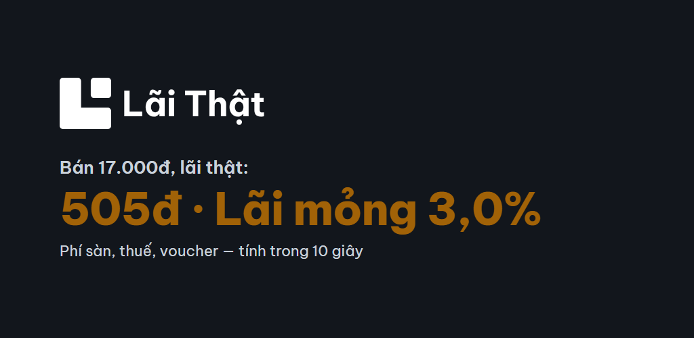
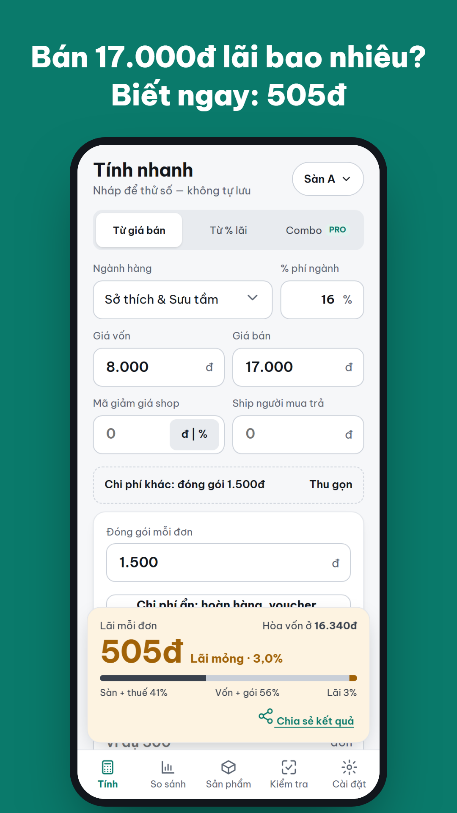
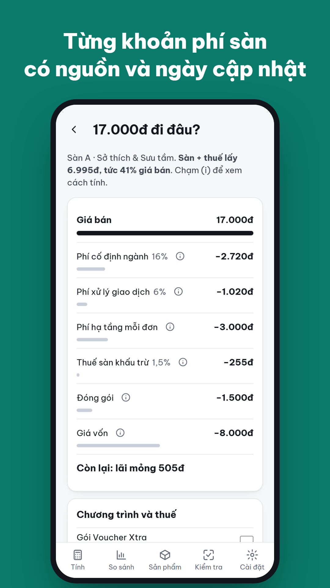
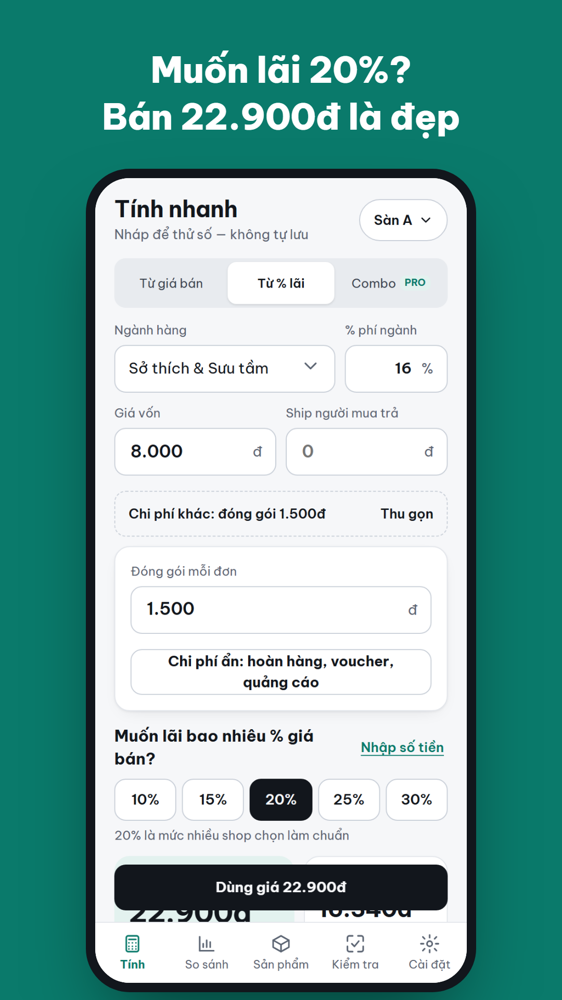
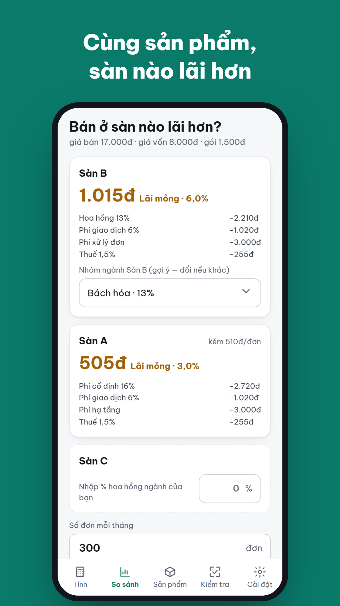
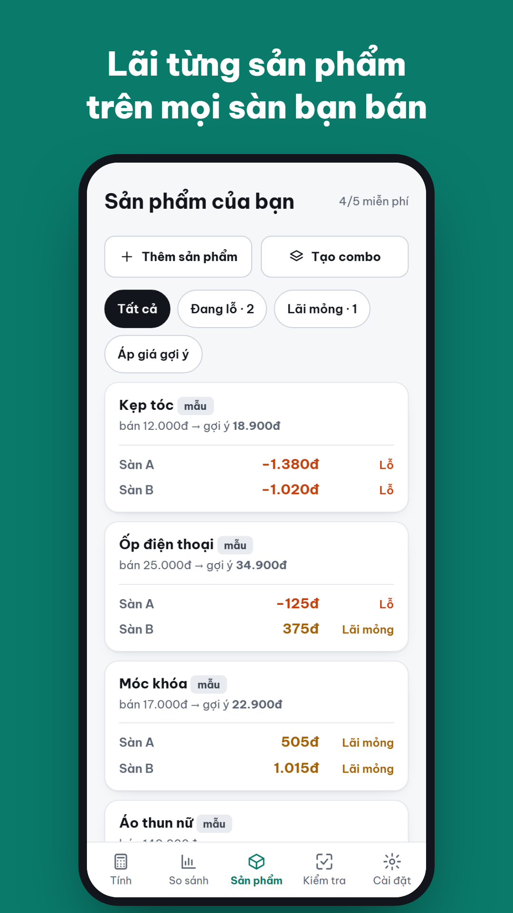
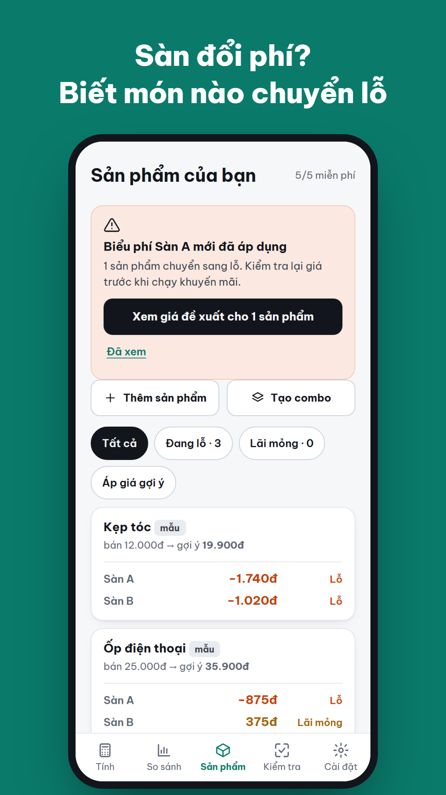
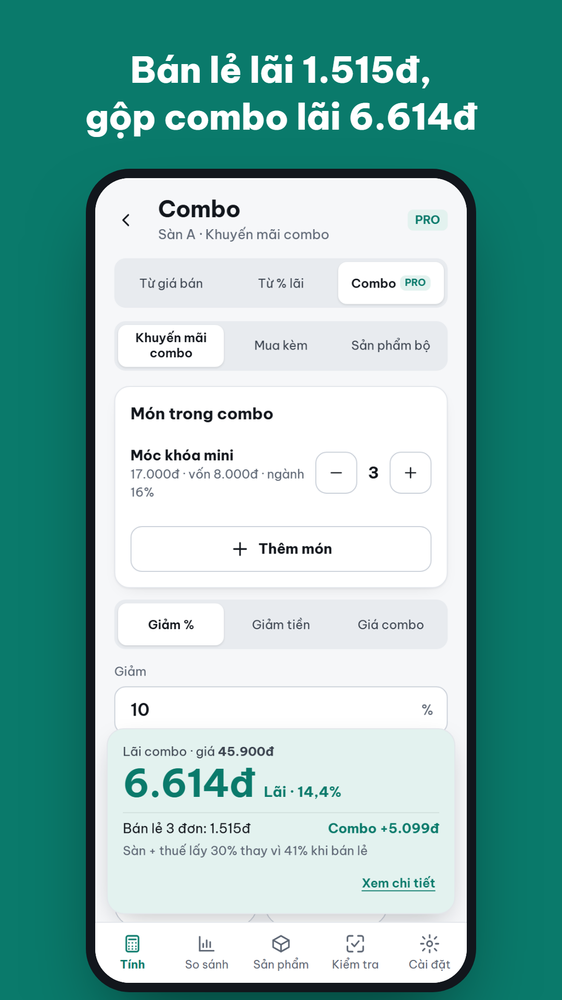
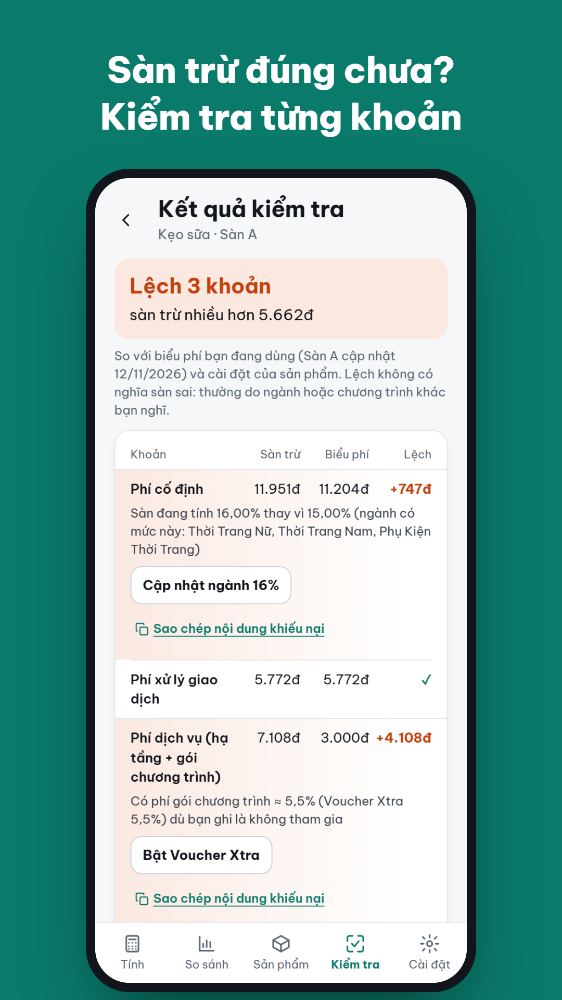

<p align="center">
  
</p>

<p align="center">
  <a href="https://youtu.be/CnKY1uwEHC0"></a>
  
  <a href="#how-to-build-run-or-access"></a>
  
</p>

# Lãi Thật: Tính Phí Sàn TMĐT

**Lãi Thật** ("real profit") is a pricing calculator for small Vietnamese online shops that sell on Shopee, TikTok Shop and Lazada. The seller types a product's cost and selling price and sees, in about 10 seconds, how much of each order they actually keep after the category fee, transaction fee, per-order fees, voucher programmes and withheld tax. They can also type the margin they want and get the price to list at, rounded to a "nice" price such as 22,900đ. Every fee line shows its formula and effective date, and the formula matches 8 real Shopee payouts to within 1đ. When a platform changes its fees, the app tells the seller which saved products just turned into a loss. It needs no login and no shop connection, and it works offline.

> Lãi Thật is an independent tool, not affiliated with Shopee, TikTok or Lazada. Fee tables are for reference and show their effective dates; the user can override every number.

**Demo video (2:59, music only):** https://youtu.be/CnKY1uwEHC0. The local copy `brand/video/lai-that-demo-2m59.mp4` (116 MB) is git-ignored because it exceeds GitHub's 100 MB file limit.

---

## The problem

Selling on Vietnamese marketplaces got more expensive in 2026. In May, Shopee, TikTok Shop and Lazada all raised their fees. Platform fees now take about **23–25% of revenue**, while a small shop's net margin is only about **7–10%**, so one fee the seller forgot is enough to turn an order from profit into loss.

The fees are layered and keep changing:
- a fixed fee by product category (up to 17% on Shopee);
- a 6% transaction fee that also applies to the shipping the buyer pays;
- a 3,000đ per-order infrastructure fee;
- optional programmes: Voucher Xtra 5.5%, PiShip 2,700đ, a visibility fee of about 1.08%;
- 1.5% tax withheld by the platform.

A keychain that costs 8,000đ and sells for 17,000đ "looks fine", but it keeps only **505đ (3.0%)**. Sellers usually learn this only when the payout arrives.

What sellers use today does not solve it:
- **Free Excel files.** E-commerce TikTok creators give them away to attract customers. One "free Shopee pricing file 2026" video has 1,857 likes and 330 comments, almost all asking "xin file" (please send me the file); some ask for an app. The files go stale every time fees change (one popular file was last updated in 08/2024).
- **Existing apps.** The only Vietnamese fee calculator on Google Play (Shopee Calc) had under 700 installs when we checked, covers only Shopee, and nothing covers TikTok Shop.
- **Order-management tools** (BigSeller, Sapo, Nhanh.vn). They show profit from real orders, but only *after* the sale, and they need a shop connection.

## Target users

Small Vietnamese online shops (1–3 people) that are not "Mall" brands. These are about 96% of shops: 661,200 shops received orders on the four largest marketplaces in the first 9 months of 2026 (Metric). Two personas:

| Persona | Who | What they need |
|---|---|---|
| **New seller** | 20–28 years old, learned to sell from TikTok, sells low-priced items on Shopee or TikTok Shop | "Is 17,000đ a profitable price?" One clear number, and the price to list at |
| **Established small shop** | 25–40 years old, sells tens to hundreds of products on 2–3 platforms, keeps an Excel price sheet | Which products lost money after the last fee change, and which platform pays best for each product |

Not our users: Mall brands with finance teams, and sellers who want full order or stock management.

Full market research (in Vietnamese): [Market Deep Dive](<docs/Market Deep Dive App tính lãi sau phí sàn.docx>). It covers market size, market problems, personas, competitors and alternatives, use scenarios, positioning, the Minimalist validation and pricing check, the prioritised requirements (MRD), MVP screens, the 3-day build plan, risks and sources.

## Core features

30 features (F1–F30), each with "Done when" criteria in `1-wiki/features/`.

| Area | What the seller gets | Plan |
|---|---|---|
| Profit from a price | Category, cost, price, shop voucher and buyer-paid shipping give profit per order, margin, break-even price and a money bar (platform + tax / cost / profit). Updates as the user types | Free |
| Price from a target margin | "I want 20%" gives a "nice" price (22,900đ) and the real profit at that price | Free |
| Fee breakdown | Each fee with its formula, source and effective date; toggles for programmes and taxes; override any rate | Free |
| Compare platforms | The same product on Shopee, TikTok Shop and Lazada, side by side | Free |
| Hidden costs | Returns, ads (break-even ROAS), affiliate | Free |
| Catalog | Saved products, lowest margin first, profit on every platform the shop sells on, one-tap suggested prices per platform | Free up to 5 products, then Pro |
| **Fee-change alert** | New fee table, so the app recalculates everything and notifies which products turned into a loss | Free shows the count; Pro shows each product and its new price |
| Flash Sale & max purchase cost | Profit at −10/20/30%; highest supplier price that keeps the target margin | Pro, or watch a rewarded ad |
| **Combo** (add-on) | Bundle 2–5 items: combo profit vs selling separately (3 keychains: 1,515đ → 6,614đ), maximum safe discount, suggested combo price, saved to catalog | Pro (free users see a read-only example) |
| **Order check** (add-on) | Type the numbers from Shopee's "Doanh thu đơn hàng" screen: the app compares each deducted fee with the fee table, explains each mismatch, fixes the product setting in one tap and copies a neutral complaint text | Free |
| Order check from file (add-on) | Read a whole Shopee *Báo Cáo Doanh Thu* .xlsx on the device: counts by status, top mismatch reason, fee share, SKU-to-product mapping | Pro (free: summary + first 3 orders) |

### What it looks like

<p align="center">
  
  
  
  
</p>
<p align="center">
  
  
  
  
</p>
<p align="center"><sub>Google Play screenshots captured from the running app (<code>node tools/store_shots.mjs</code>). Platform names appear as "Sàn A/B/C" to follow store policy.</sub></p>

## Launch channel

**Google Play**, Apero's publishing channel, category Business, with a Vietnamese store listing (`docs/STORE_LISTING.md`).
- The Android app is the web app packaged with Capacitor. It uses native AdMob and Google Play Billing (`mobile/`, ADR-002).
- The same build also runs as an installable PWA on the open web, which we use for demos and sharing before the Play release.
- The title carries the words sellers search for ("Tính Phí Sàn TMĐT"). Platform names and logos never appear in the icon, title or screenshots, to follow Google Play's impersonation policy.

## How the product gets users and revenue

**Getting users.** We go where sellers already ask for this tool:
1. **Seller communities.** These are the TikTok videos, Facebook seller groups and Zalo groups where people comment "xin file". Short demos of the "8k cost, 17k price, still a loss?" moment answer exactly what they are asking.
2. **In-app sharing.** A result card can be shared to Zalo, so every shared result points another seller to the app.
3. **Google Play search** for "tính phí Shopee", "tính lãi", "phí sàn".
4. **Fee-change moments.** Every new fee table pushes sellers to recheck their prices. The app recalculates the catalog and alerts users, and launch content can be timed to these moments.
5. **Apero's paid user acquisition** (Google, Facebook, TikTok) once the app passes gating. The tracking plan is built so those campaigns can be optimised.

**Making money.** Freemium:
- **Ads (AdMob).** Adaptive banners on the Catalog and Fee-settings screens, an interstitial at most every 3 minutes after the 3rd calculation (never in the first 2 sessions), and rewarded ads that unlock Flash Sale once. No ads ever appear on the profit calculator, the combo builder or the order-entry screen.
- **Lãi Thật Pro.** Subscription at 49,000đ/month with a 3-day trial, or 299,000đ/year. It gives an unlimited catalog, per-product fee alerts, Flash Sale and max cost, Combo, file order check, and no ads.
- **Willingness to pay.** A Korean cross-border Shopee pricing app (Shopee PriceTool) has more than 50,000 installs and charges up to 29,000 won a month, which shows sellers do pay for this kind of tool.

The paywall appears at 4 core points, plus 2 add-on points. **Calculation is never locked:** profit, fee breakdown, target margin and platform comparison stay free.

## How to build, run or access

Requirements: Node.js 22 or later. The web app needs no `npm install`: it is plain ES modules, has no build step and pulls nothing from a CDN.

```bash
node 2-environment/serve.mjs          # open http://localhost:5173 (use a phone-size viewport)
bash 3-verification/verify.sh         # 134 unit tests + a bot that uses the app like a seller (230 checks, screenshots in reports/latest/)
node --test app/tests/*.test.js       # unit tests only
```

**Android (Google Play build)** is in `mobile/`. Full steps, including the AdMob App ID and Play Billing products, are in `mobile/README.md`.

```bash
cd mobile && npm install && npm run sync && npm run open   # opens Android Studio → Build › Generate Signed Bundle (AAB)
```

**Fee engine reference and validation against real orders:**

```bash
python tools/validate.py   # 8 real Shopee orders: app vs payout differ by 0–1đ (docs/VALIDATION_REPORT.md)
python tools/addons.py     # combo + order-check reference (source of app/test/addon_vectors.json)
```

Status:
- All 30 features pass `verify.sh`.
- Phase reviews with screenshots are in `4-memory/pm-review.md`.
- Launch steps that need team accounts are tracked in `docs/LAUNCH_CHECKLIST.md`: Play Console, AdMob, Firebase project, signing key and privacy-policy URL.

## AI-native workflow: how we used Claude

We used Claude in two stages: first to find a product worth building (wide market research), then to build it.

### A. Wide market research with Claude: finding the idea

We did not start with this idea. Before building, we ran Claude through several research passes. Claude ran the searches; the team set the rules and made every keep or drop decision. The research is written up in four Claude Docs reports: *Market Research*, *Product Discovery v1*, *Product Discovery v2* (7 rounds) and *Market Deep Dive*. The *Market Deep Dive* for the chosen idea is in the repository: [Market Deep Dive](<docs/Market Deep Dive App tính lãi sau phí sàn.docx>).

1. **Scoring against what Apero publishes.** Claude first studied Apero's Google Play portfolio and business model, then scored 6 AI app ideas from 1 to 5 on six criteria: Apero fit, money, competitive gap, AI as the core, shippable in 3 days, and policy risk. It backed every score with store evidence (installs, ratings, revenue estimates, clones). The top score went to a document "scan and explain" app (25/30). We then widened the search to everyday problems in the Vietnamese market.
2. **Product discovery with PM skills.** Claude listed Vietnamese market problems with evidence × impact, built personas, and then mapped competitors and positioning. The winner was a rental-room electricity-bill app ("Hóa Đơn Trọ", 17/20). A second, wider competitor check found many existing apps for landlords (LOZIDO, Ecorent, Trọ Mới, Rento…), so **we dropped it**. The repository started under that name and was later renamed "Lãi Thật".
3. **An iterative loop with gates (7 rounds, about 35 parallel research agents, more than 70 ideas screened).** Every idea had to pass gates before it was kept. When one failed, Claude went back to searching. The team added or changed a gate whenever a round showed the rules were wrong:

   | Round | What Claude did | What we learned |
   |---|---|---|
   | 1 | 4 research branches read complaints from forums (Voz, Tinhte, Webtretho, Reddit), Facebook, TikTok, Threads, the press and new laws, then checked competitors widely (Google Play, App Store, web tools, Zalo mini apps, Chrome extensions, "top apps" articles) | 17 ideas kept, about 35 dropped because a competitor already existed |
   | Gate 0 | Team rule added: **the problem must be painful enough** (frequent and severe) | A motorbike-emission checker ("Xe Tôi") had no competitor but was dropped: people check once and forget |
   | 2 | 3 new branches (forums, press, TikTok comments), pain gate first | Ideas such as overtime logging and flood maps dropped: apps already exist |
   | 3 | *The Minimalist Entrepreneur* skills (find-community, validate-idea, mvp, pricing). **8 agents in parallel, one per community** (students, exam takers, tutors, young workers, online sellers, freelancers, pet owners, parents), each looking for how people "hack" a solution today | No idea passed all gates: wherever people pay, a Vietnamese app already exists |
   | 4 | Relaxed the competitor gate (weak leader under 4★, foreign-only apps, small abandoned Vietnamese apps). 4 agents | Online research alone cannot prove willingness to pay |
   | 5 | Replaced "no competitor" with a **gap gate**: at least 3 independent complaints about the same missing thing, still unfixed, which a 2–3-day MVP can fill. 8 agents across 8 verticals | Competitors became evidence of demand, not a reason to stop |
   | 6 | 8 agents, **one per channel**: "is there an app for…" questions, TikTok and YouTube, Excel/Notion templates, app-store reviews, new 2025–2026 regulations, trades and farmers, Gen Z trends, English and Southeast Asian sources | "Real profit after marketplace fees" surfaced from 3 agents independently |
   | 7 | The search tools could not read the places where Vietnamese users complain most (TikTok comments, Facebook groups, Play reviews). So Claude **opened TikTok and Google Play directly in a browser**, searched for demand signals ("tặng file Excel", "xin app", "có app nào"), counted likes and comments, and cross-checked Google Play for existing apps | Sellers asking for fee spreadsheets was the strongest signal of all, with a clear gap on Google Play |

4. **Confirming the winner on every channel.**
   - TikTok and YouTube: a free pricing-file video with 1,857 likes and 330 "xin file" comments, "E xin app" requests, "Bán Shopee nhập 8k bán 17k vẫn lỗ???" (cost 8k, price 17k, still a loss?, 266 likes) and a TikTok Shop cost-reconciliation video with 1,824 likes.
   - Threads: complaints such as "I raised prices several times and still sell many items at a loss without noticing".
   - Facebook seller groups: "please send a Shopee fee file by category" posts. A team member logged in; Claude only read and never posted.
   - Google Play: no Vietnamese app does the job well, and a Korean paid app proves sellers pay for pricing tools.
5. **Deep dive on the chosen idea.** Claude used marketing-research and PM skills (market problems, personas, competitive landscape, use scenarios, positioning, requirements) and the Minimalist validate/mvp/pricing skills. The deep dive produced the market size, personas and positioning, the formula, and a prioritised feature list (evidence × impact).
6. **Ground truth before building.**
   - **Fees:** read from official Shopee Uni pages and fee PDFs (1,439 category rows).
   - **Payouts:** taken from real orders and from seller videos that show payout screens (Claude read the YouTube transcripts and video frames).
   - **Interface:** screenshots of 18 competitor tools (Play Store pages, web calculators, Excel files) to choose UI patterns.

   This is where the 8-order validation and the later Order-check add-on came from.

### B. Building with Claude

We built the whole product with Claude (Claude Code) in a "harness" adapted from Apero's sessions. Claude plays both **builder** and **product manager**. The team acts as **product owner (PO)**: we decide scope, answer open questions and approve deliverables.

1. **Raw sources in, Wiki out.**
   - `raw/` is read-only and holds our inputs: fee announcements, 8 real order screenshots turned into numbers, the launch kit and the add-on spec.
   - Claude turns them into a Wiki that acts as the single source of truth: fee tables with source and date (`1-wiki/fees/`), one formula (`1-wiki/engine/formula.md`), product decisions and ADRs, and one page per feature with **"Done when" criteria**.
   - When code and Wiki disagree, the code is wrong. Unclear points go to `4-memory/po-questions.md` for the PO.
2. **Tests first, then code.**
   - A Python reference engine (`tools/engine.py`) is checked against real orders. The JavaScript engine must match it to the đồng through shared test vectors.
   - Each feature gets `app/tests/F<n>.test.js` before UI work, and Claude must not edit a test to make it pass.
3. **Only one command can say "done".**
   - `bash 3-verification/verify.sh` runs the unit tests plus a Chrome bot (`app/e2e.mjs`) that taps and types like a seller and takes screenshots.
   - A feature goes from claimed 🟡 to passing ✅ only when this run is green. Claude cannot mark a feature passing by itself.
4. **PM review per phase.** Claude looks at the bot's screenshots, scores the design on 5 points (the "look before claim" rule), checks the phase's "Done when" list and writes ĐẠT / CHƯA ĐẠT in `4-memory/pm-review.md`.
5. **Skills for specialised work:**
   - UI/UX (`ui-ux-pro-max`, design canvases in `1-wiki/design-canvas/`);
   - logo design and a Lottie splash animation (`logo-design`, `wiggle`);
   - the store screenshots (`tools/store_shots.mjs`);
   - the demo video, music only, built with the ultrademo skill.
6. **Iterating with the PO.** The PO's feedback became new phases (10 phases in total, `1-wiki/phases.md`):
   - Quick-calc vs saved products separated;
   - profit across every platform the shop sells on;
   - suggested price per platform;
   - Capacitor instead of TWA so AdMob works;
   - the Combo and Order-check add-on.

**What worked**
- **Research gates that the team owned.** Claude can screen dozens of ideas in parallel, but it never decided on its own. Clear gates (painful enough, a real gap, money, shippable in 3 days, policy-safe) let us drop two ideas we had liked (Hóa Đơn Trọ, Xe Tôi) quickly, before writing any code.
- **Reading users directly.** The strongest evidence came only after Claude read TikTok comments, Facebook groups and Google Play in a browser. Searching the press had not found it.
- **Real orders as ground truth.** Matching 8 real Shopee payouts to within 1đ caught fees the public tables miss: PiShip, the 1.08% visibility fee, and an order where VAT was not withheld. That became the Order-check feature.
- **"Done when" plus a bot gave Claude a clear finish line.** Regressions across 30 features were caught automatically: 230 bot checks in each run.
- **Writing decisions down** (`1-wiki/product/decisions.md`, ADRs, `1-wiki/learned.md`) kept long sessions consistent after context resets.

**What didn't (and what we changed)**
- **Gates that fight each other.** "No competitor" and "people already pay" pulled in opposite directions: wherever people pay, an app already exists. Three rounds passed without a winner. Fix: treat competitors as proof of demand and look for the gap they leave (round 5).
- **Search tools are blind to Vietnamese social media.** Forums, Facebook, TikTok comments and Play search blocked automated reading, so early rounds leaned on press articles. Fix: read those pages in a browser, with a team member logged in where needed; Claude only read and never posted.
- **A green bot is not proof on its own.** One screen showed "undefined" while all checks passed. Fix: always look at the screenshots, and add checks for undefined/NaN text.
- **Bot test state leaked between phases.** An earlier phase pushes a test fee increase, so later screens showed different numbers. Fix: the add-on phase starts like a fresh install.
- **TWA (web-in-Android) cannot run AdMob,** and Play Billing through TWA needs a server. We switched to Capacitor with native plugins (ADR-002).
- **Recording the screen.** The first attempt (getDisplayMedia) captured the whole desktop. That file was deleted immediately, and recording now uses only the app page.
- **We cut what we could not verify.** Mall shops were dropped (13/11): they are not our target users and there is no sourced Mall fee table, so the app now serves regular shops only.
- **Some inputs are still assumptions** and are listed for the PO:
  - the exact column names in Shopee's revenue .xlsx;
  - how a combo discount is split across categories;
  - willingness to pay, which still needs real user interviews (the "talk to 10 people" step).

## Tracking plan

**Full tracking plan: [Tracking Plan - Lai That.docx](<docs/Tracking Plan - Lai That.docx>)** (Word). The machine-readable spec used by the code and tests is [docs/TRACKING_PLAN.md](docs/TRACKING_PLAN.md). (each event, what it measures, why it matters, funnel and KPI targets).

- 32 events cover the funnel install → `onboarding_completed` → `calc_completed` → `product_saved` → `paywall_view` → `purchase`, plus ads, sharing, fee alerts, Combo and Order check.
- No price, cost, product name, order ID or file content is ever sent, only buckets and reason codes.
- Key targets: activation ≥ 70%, D1/D7 retention ≥ 25% / ≥ 12%, paywall → purchase ≥ 2%, fee reports < 1% of calculations.

## Store policy and compliance

- **Privacy policy** in-app (`app/privacy.html`, linked from Settings). Data stays on the device, and the order-check file is read on the device and never uploaded. Google Play Data-safety answers are in `docs/STORE_LISTING.md`.
- **Ads.** A consent dialog (UMP) before the first ad, personalised or non-personalised. No ads on the calculator, combo builder or order entry.
- **Paywall.** It shows the price and period, auto-renewal, how to cancel in Google Play, a reminder 1 day before the trial ends, and Restore purchases.
- **No platform names, logos or colours** in the icon, title or screenshots (store screenshots use "Sàn A/B/C"). The not-affiliated disclaimer appears on every result screen.
- **Store assets:**
  - Google Play listing, Vietnamese (`docs/STORE_LISTING.md`);
  - 8 screenshots at 1080×1920, a feature graphic and a 512 px icon (`brand/store/`);
  - logo and splash animation (`brand/`).

<p align="center">
  
  &nbsp;&nbsp;&nbsp;
  
</p>
<p align="center"><sub>App icon and the opening animation: the fee piece splits off and what remains is the real profit. Logo kit and usage guide: <code>brand/logo/</code>.</sub></p>

## Team

| Member | Role | Contributions |
|---|---|---|
| Vo Huynh Quoc Thai | Product owner · AI build lead | Runs the Claude harness (Wiki → tests → code → verify → PM review), decides scope and answers PO questions, approves each phase and the demo video |
| Luong Thi Phuong Thao | Product & market research | Target users and personas, competitor review, pricing and monetization (free vs Pro, ad rules) |
| Nguyen Thi Thanh Truc | UX/UI & brand | Design direction and screen review, logo and splash, store screenshots and listing copy |
| Nguyen Vinh | Fee data & validation | Fee tables with sources and dates, collecting real Shopee orders, checking the engine and the order-check add-on against them |
| Vu Khang | QA, tracking & launch | Testing on phones, tracking plan, privacy policy and Play policy checklist, launch steps |

Roles are a first split; each member should adjust their own row to what they actually did before submitting.

## Repository structure

```
raw/                 source material, read-only (fee announcements, real orders, launch kit, add-on spec)
1-wiki/              ① Wiki, the source of truth: fees/, engine/formula.md, product/ (decisions, ADRs), features/ (Done when), phases.md, screens.md, design/
2-environment/       ② rules for the AI (rules.md), dev server, Chrome bot
3-verification/      ③ verify.sh: the only thing that can mark a feature ✅
4-memory/            ④ features.json, progress.md, pm-review.md, po-questions.md
app/                 the product: engine.js · calc.js · addons.js · xlsx.js · store.js · ui.js · ui-addons.js · pro.js · ads.js · billing.js · native.js · tests/
mobile/              Capacitor Android project (AdMob + Play Billing)
tools/               Python reference engine, validation, store screenshots
docs/                tracking plan (.docx + spec .md), market deep dive, store listing, launch checklist, validation report, demo script
brand/               logo, splash animation, store screenshots, demo video
flutter/             Dart port of the fee engine (kept in sync, not shipped)
```
