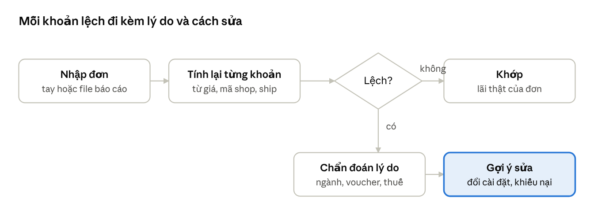

# Lãi Thật Add-on: Combo & Kiểm tra đơn

13/11/2026 · Bản Docs (có sơ đồ): https://claude.ai/artifact/H9Xdfa52JfeaEFPunA6VpY

## Tóm tắt

Hai add-on này mở rộng Lãi Thật từ “tính một sản phẩm” sang “bán theo bộ” và “kiểm tra tiền sàn trả”, hai việc người bán đang làm tay. Cả hai dùng chung bộ máy tính đã khớp 8/8 đơn Shopee thật, không cần đăng nhập hay API sàn.

| Add-on | Trả lời câu hỏi | Vì sao có giá trị | Gói |
| --- | --- | --- | --- |
| **Combo** | Bán theo bộ (3 móc khóa, áo + quần, món chính + món mua kèm) thì giá bao nhiêu, lãi bao nhiêu, giảm tối đa bao nhiêu? | Phí hạ tầng, PiShip, đóng gói tính **mỗi đơn**: gộp 3 món vào 1 đơn thì chỉ trả 1 lần. 3 móc khóa bán lẻ lãi 1.515đ; bán combo giảm 10% lãi 6.614đ | Pro toàn bộ (người dùng miễn phí xem ví dụ mẫu 3 móc khóa; tự dựng combo cần Pro hoặc dùng thử 3 ngày) |
| **Kiểm tra đơn** | Sàn trừ đúng chưa, lệch ở khoản nào, vì sao? | Người bán chỉ biết phí sau khi bán; công cụ đối soát hiện có (AutoShopee, Sapo) chỉ so tiền về với doanh thu, không nói phí nào sai | Nhập tay 1 đơn: miễn phí; nhập file Báo Cáo Doanh Thu nhiều đơn + chẩn đoán: Pro |

Ưu tiên build: Combo (gói Pro) và Kiểm tra đơn nhập tay đi cùng bản 1.1 (khoảng 1,5 ngày); nhập file Báo Cáo Doanh Thu ở bản 1.2 (khoảng 1 ngày). Nếu muốn có trong bản nộp 15/11, chỉ nên thêm Combo, và chỉ sau khi phần lõi đã chạy.

## Combo: sàn tính phí thế nào

Điểm mấu chốt: mỗi khoản phí sàn có **một đơn vị tính riêng**. Combo thay đổi lãi vì nó gộp nhiều sản phẩm vào một đơn, nên khoản tính theo đơn chỉ trả một lần, còn khoản tính theo % thì tính trên giá đã giảm.

| Khoản | Đơn vị tính | Combo 3 món trong 1 đơn | Nguồn |
| --- | --- | --- | --- |
| Phí cố định ngành (Shopee non-Mall 2–17%) | % × giá sau giảm của **từng sản phẩm**, theo ngành của sản phẩm đó | Mỗi món tính theo ngành của nó, trên phần giá sau khi chia khuyến mãi | Shopee Uni bài 2139 |
| Phí xử lý giao dịch 6% | % × (giá sau mã giảm giá shop + ship người mua trả) | Tính trên tổng tiền đơn | Shopee Uni bài 2150 |
| Phí hạ tầng 3.000đ | **mỗi đơn** | Trả 1 lần thay vì 3 | Shopee Uni bài 25223 |
| PiShip 2.700đ | mỗi đơn | Trả 1 lần | Đơn thật A, B |
| Voucher Xtra 5,5% | % × giá, **trần 50.000đ mỗi sản phẩm** | Trần áp cho từng món, không cho cả đơn | fee\_presets v2, đơn thật |
| Phí hiển thị \~1,08% | % × doanh thu đơn | Tính trên tổng đơn | Đơn thật A |
| Thuế khấu trừ 1% GTGT + 0,5% TNCN | % × doanh thu | Tính trên tổng đơn | Nghị định 117/2025 |
| Đóng gói, vận chuyển phía shop | chi phí của shop, mỗi đơn | Trả 1 lần | Người dùng nhập |

Ví dụ 3 móc khóa (giá vốn 8.000đ, giá lẻ 17.000đ, ngành 16%, đóng gói 1.500đ/đơn): bán lẻ mỗi chiếc lãi 505đ (3%), 3 đơn lẻ là 1.515đ. Gộp 3 chiếc thành combo giảm 10% (45.900đ): sàn lấy 30% thay vì 41%, lãi 6.614đ (14,4%), gấp hơn 4 lần.

### Ba cách bán theo bộ trên Shopee

- **Combo Khuyến Mãi** (Kênh Marketing): người mua chọn từ 2 sản phẩm trong danh sách; giảm theo %, theo số tiền, hoặc giá combo đặc biệt. Mức giảm tối thiểu 5% hoặc 10.000đ; số lượng mua tối thiểu dưới 5. Phần giảm được ghi vào "Số tiền bạn trợ giá", làm giảm giá sản phẩm, nên phí % tính trên giá đã giảm.
- **Mua Kèm Deal Sốc**: giảm giá cho sản phẩm mua kèm khi mua sản phẩm chính; chương trình chạy tối đa 3 tháng. Về phí giống combo: món mua kèm đi chung đơn nên không chịu thêm phí hạ tầng, đóng gói.
- **Đăng một sản phẩm là "Bộ 3"** (một mã SKU riêng): sàn coi là một sản phẩm. Trần Voucher Xtra 50.000đ áp cho cả bộ thay vì từng món, và phí ngành theo ngành của sản phẩm đăng.

App cho người dùng chọn một trong hai chế độ: **Khuyến mãi combo** (chương trình 1 và 2) hoặc **Sản phẩm bộ** (cách 3), vì trần voucher và ngành tính khác nhau.

TikTok Shop và Lazada có công cụ tương tự (Combo/Bundle, Mua thêm giảm giá). Cùng cấu trúc: phí % tính trên giá sau giảm, phí cố định tính theo đơn (Lazada 3.000đ/đơn). Chưa có đơn thật để đối chiếu nên app ghi "chưa đối chiếu đủ" như phần lõi.

Điều chưa chắc chắn: Shopee chia phần giảm của combo cho từng món theo tỷ lệ giá trị (cách app dùng) hay theo cách khác. Tổng phí không đổi nếu các món cùng ngành; chỉ lệch khi các món khác ngành. Cần 1–2 đơn combo thật khác ngành để xác nhận.

## Combo: đối thủ và mẫu UI học được

| Công cụ | Cách làm combo | Học được gì | Thiếu gì |
| --- | --- | --- | --- |
| Công cụ Combo Khuyến Mãi trong Kênh Người Bán Shopee | Chọn sản phẩm, chọn kiểu giảm (%, số tiền, giá đặc biệt), số lượng tối thiểu | Dùng đúng 3 kiểu giảm và các giới hạn này, người bán nhập xong trong app là gõ lại được trên sàn | Không cho biết lãi sau phí; không so với bán lẻ |
| Sapo: báo cáo bán hàng sản phẩm combo quy đổi | Combo là một mã gồm nhiều sản phẩm thành phần; báo cáo quy đổi về từng sản phẩm | Bảng so sánh "bán lẻ vs bán trong combo" | So doanh thu, không so lãi; chỉ sau khi đã bán |
| KiotViet / Sapo / Nhanh: hàng combo, đóng gói | Giá vốn combo = tổng giá vốn thành phần, trừ kho từng thành phần | Lấy giá vốn từ sản phẩm đã lưu, không bắt gõ lại | Không có phí sàn theo đơn |
| KitchenCost (tính giá món ăn, iOS) | Công thức con: đổi giá nguyên liệu là mọi món dùng nó tự tính lại | Combo lưu liên kết tới sản phẩm: sửa giá vốn móc khóa là combo tính lại, và báo động đổi phí phủ cả combo | Không phải TMĐT |
| TOPDATA, Shopee Calc, file Excel | Chỉ tính một sản phẩm | — | Không có combo: đây là khoảng trống |

Mẫu UI chọn đưa vào app:

1. **Thêm món từ danh mục** (như KiotViet): chọn sản phẩm đã lưu, giá vốn và ngành tự điền; có nút thêm món nhanh nếu chưa lưu. Bước số lượng +/− trên từng dòng.
2. **Kiểu giảm dạng 3 tab** giống công cụ Shopee: Giảm % · Giảm tiền · Giá combo. Báo ngay nếu dưới mức tối thiểu của sàn (5% / 10.000đ).
3. **Thẻ kết quả dính đáy** như màn Tính lãi, thêm dòng so sánh: "Bán lẻ 3 đơn: 1.515đ · Combo: 6.614đ (+5.099đ)".
4. **Thanh trượt mức giảm** với 2 mốc vẽ sẵn: "giữ lãi 20%" và "hòa vốn" (ý tưởng từ slider % lãi của Shopee Calc).
5. **Combo là một dòng trong Danh mục** với nhãn "Bộ", nên xếp hạng lãi thấp và báo động đổi phí dùng chung.

## Combo: tính năng, màn hình, công thức

### Tính năng

| # | Tính năng | Gói | Ghi chú |
| --- | --- | --- | --- |
| C0 | Mở tab Combo khi chưa có Pro: thấy ví dụ mẫu 3 móc khóa (bán lẻ 1.515đ → combo 6.614đ), chỉ xem | Miễn phí | Bấm sửa bất kỳ ô nào → paywall (dùng thử 3 ngày) |
| C1 | Tạo combo 2–5 món từ danh mục hoặc nhập nhanh (tên, giá vốn, giá lẻ, ngành, số lượng) | Pro |  |
| C2 | Kiểu giảm: %, số tiền, giá combo; cảnh báo dưới mức tối thiểu của sàn | Pro |  |
| C3 | Chế độ: Khuyến mãi combo / Mua kèm / Sản phẩm bộ | Pro | Khác nhau ở trần Voucher Xtra và ngành |
| C4 | Kết quả: lãi combo, % lãi, sàn lấy bao nhiêu %, chi tiết phí | Pro | Dùng lại thẻ kết quả và bảng phí của màn Tính lãi |
| C5 | So với bán lẻ cùng số món (mỗi món một đơn) | Pro | Đây là khoảnh khắc "à há", nên ví dụ mẫu ở C0 hiện sẵn dòng này |
| C6 | Mức giảm tối đa để giữ % lãi mục tiêu và để hòa vốn; giá combo gợi ý (giá đẹp) | Pro |  |
| C7 | Lưu combo vào Danh mục, tự tính lại khi sửa giá vốn món thành phần hoặc khi sàn đổi phí; báo động đổi phí cho combo | Pro | Hết Pro: combo đã lưu vẫn hiện trong Danh mục (chỉ xem), không bị xóa |

Không làm ở bản này: quản lý kho thành phần, đồng bộ combo lên sàn, combo khác sàn trong một bộ.

### Luồng màn hình

1. Tab Tính lãi có chip chế độ mới **Combo** cạnh "Từ giá bán" và "Từ % lãi", có nhãn PRO; chưa có Pro thì mở ra ví dụ mẫu chỉ xem, sửa ô nào cũng mở paywall. Danh mục có nút "Tạo combo" khi đã lưu từ 2 sản phẩm.
2. **Màn Dựng combo**: sàn (chip), chế độ combo, danh sách món (tên · giá lẻ · số lượng +/−), nút "+ Thêm món" mở bảng chọn từ danh mục. Dưới: kiểu giảm 3 tab, ô nhập; đóng gói, ship người mua trả (tính 1 lần). Cộng giá lẻ → gạch ngang → giá combo.
3. **Thẻ kết quả dính đáy**: lãi combo + % + trạng thái màu (Lãi / Lãi mỏng / Lỗ), dòng so bán lẻ, nút "Xem chi tiết".
4. **Chi tiết combo**: bảng phí như màn lõi, thêm nhãn "mỗi đơn" / "mỗi sản phẩm" cạnh từng dòng; phần "Giảm tối đa" với thanh trượt và 2 mốc; nút Lưu combo.
5. Danh mục hiện combo như một dòng có nhãn "Bộ · 3 món".

### Công thức

Món i có giá lẻ pᵢ, số lượng qᵢ, giá vốn Cᵢ, tỷ lệ ngành cᵢ. Tổng giá lẻ G = Σ pᵢqᵢ.

- Giá combo B: giảm % d → B = G(1−d); giảm tiền D → B = G−D; giá đặc biệt → B nhập trực tiếp. Trừ thêm mã giảm giá shop nếu có.
- Chia giảm theo tỷ lệ giá trị: giá sau giảm mỗi đơn vị bᵢ = pᵢ · B/G.
- Phí sàn = Σ cᵢbᵢqᵢ + t(B + ship người mua trả) + Σ min(v·bᵢ, 50.000)qᵢ + vis·B + F (phí mỗi đơn: hạ tầng 3.000 + PiShip 2.700 nếu bật).
- Lãi combo = B − phí sàn − thuế·B − (affiliate + 1/ROAS)·B − Σ Cᵢqᵢ − đóng gói; sau đó áp hoàn hàng như màn lõi: (1−r)·lãi − rR.
- Chế độ Sản phẩm bộ: một món duy nhất với giá B, giá vốn ΣCᵢqᵢ, ngành do người dùng chọn, trần 50.000đ một lần. Gọi thẳng hàm tính của màn lõi.
- So bán lẻ = Σ qᵢ × lãi một đơn chỉ có 1 món i, giá pᵢ (mỗi đơn chịu phí mỗi đơn và đóng gói).
- Giảm tối đa cho % lãi m: tìm nhị phân d ∈ \[0; 95%\] (lãi giảm dần theo d, có điểm gãy ở trần voucher nên không dùng công thức đóng). m = 0 cho mức hòa vốn.
- Làm tròn: chỉ khi hiển thị. Mức giảm gợi ý làm tròn **xuống** số % nguyên (để không vượt mức an toàn); giá combo gợi ý làm tròn **lên** giá đẹp (x.900đ dưới 100.000đ, x9.000đ từ 100.000đ).
- Nếu mức giảm để đạt mục tiêu nhỏ hơn mức tối thiểu của sàn (5%), app nói rõ: "Giảm 5% (mức thấp nhất Shopee cho phép) thì lãi còn 17,7%".

### Ca kiểm thử (đã chạy bằng tools/addons.py)

| Ca | Đầu vào | Kết quả mong đợi |
| --- | --- | --- |
| CB1 | 3 móc khóa (vốn 8.000, giá 17.000, 16%), đóng gói 1.500, bán lẻ | 3 × 505 = 1.515đ |
| CB2 | Như trên, combo không giảm | 51.000đ, lãi 10.515đ (20,6%), sàn + thuế lấy 29,4% |
| CB3 | Giảm 5% / 10% / 15% | 8.564đ (17,7%) / 6.614đ (14,4%) / 4.663đ (10,8%) |
| CB4 | Giảm tối đa giữ lãi 20% / 10% / hòa vốn | 1,1% / 16,0% / 27,0% |
| CB5 | Giá combo cho lãi 20% | 50.442đ → gợi ý 50.900đ (dưới mức giảm tối thiểu 5% → hiện cảnh báo) |
| CB6 | Mua kèm: áo (vốn 60.000, giá 149.000, 16,5%) + móc khóa giá mua kèm 11.900, đóng gói 3.000 | Áo một mình 47.240đ; thêm móc khóa 48.344đ (+1.104đ, dù móc khóa bán lẻ riêng chỉ lãi 505đ ở giá 17.000đ) |
| CB7 | 2 nồi (vốn 150.000, giá 300.000, ngành 10%) giảm 10%, Voucher Xtra + PiShip, đóng gói 5.000; và 2 món giá 1.200.000đ có Voucher Xtra | Combo lãi 105.100đ, thấp hơn bán lẻ 140.600đ: với hàng giá cao, giảm 10% mất nhiều hơn phần phí mỗi đơn tiết kiệm được. Món 1.200.000đ: voucher 66.000đ mỗi món bị chặn ở 50.000đ → 100.000đ; chế độ Sản phẩm bộ chỉ chặn một lần → 50.000đ |
| CB8 | Giảm 100% hoặc giá combo ≤ 0 | Báo lỗi nhập, không tính |

## Kiểm tra đơn: người bán đối soát thế nào hiện nay

Họ chỉ biết phí thật **sau khi đơn hoàn tất**. Cách thường gặp: mở chi tiết từng đơn trong Kênh Người Bán, hoặc xuất báo cáo về Excel rồi so với giá vốn. Phần mềm quản lý đơn (BigSeller, Sapo, AutoShopee) lấy số qua API, nhưng chỉ so tiền về ví với doanh thu. Chúng không nói khoản nào bị tính sai so với biểu phí.

### Nguồn số liệu người bán có sẵn

| Sàn | Nguồn | Dạng | Dùng cho |
| --- | --- | --- | --- |
| Shopee | Chi tiết đơn hàng → Doanh thu đơn hàng | Trên màn hình, từng đơn | Nhập tay 1 đơn (bản 1.1) |
| Shopee | **Báo Cáo Doanh Thu** (Tài chính → Doanh thu → Tải báo cáo) | .xlsx: Summary, Service Fee Details, Adjustment, Shipping Fee Discrepancy, Income (mỗi dòng 1 đơn hoặc 1 SKU, lọc theo cột "Đơn hàng/Sản phẩm") | Nhập file nhiều đơn (bản 1.2) |
| TikTok Shop | Tài chính → Sao kê / Chi tiết đơn thanh toán | Màn hình + .xlsx | Nhập tay; file khi có mẫu thật |
| Lazada | Tài chính → Sao kê tài khoản | .xlsx | Sau, khi có mẫu thật |

Cột trong trang Income (Shopee) app cần: Mã đơn hàng, Giá sản phẩm, Số tiền hoàn lại, Mã giảm giá (shop), Người bán hoàn xu, Phí cố định, Phí dịch vụ, Phí xử lý giao dịch, Phí hoa hồng tiếp thị liên kết, Thuế GTGT, Thuế TNCN, phí vận chuyển người mua trả, Đền bù, Tổng tiền đã thanh toán. Trang Service Fee Details tách Phí dịch vụ thành hạ tầng, Voucher Xtra, PiShip, hiển thị.

### Vì sao tiền về khác với dự tính

| Nguyên nhân | Dấu hiệu trong số liệu | App chẩn đoán bằng |
| --- | --- | --- |
| Ngành hàng trên sàn khác ngành người bán nghĩ (phí theo ngành cấp 3) | Phí cố định ÷ giá sau mã shop ≠ tỷ lệ đã chọn | Tính ngược tỷ lệ thật, đề nghị cập nhật ngành của sản phẩm |
| Đang trong Voucher Xtra / gói chương trình mà không nhớ | (Phí dịch vụ − 3.000) ÷ giá ≈ 5,5% | Bật công tắc chương trình cho sản phẩm |
| Phí hiển thị (từ 29/05/2026 Shopee trừ ≥1% mỗi đơn vào tài khoản quảng cáo) | Dòng riêng ≈ 1,08% | Bật công tắc |
| PiShip bật | 2.700đ/đơn | Bật công tắc |
| Ship người mua trả làm tăng phí giao dịch | Phí giao dịch ÷ giá > 6% | Hiện công thức có cộng ship |
| Đơn affiliate | Có Phí hoa hồng TTLK | Ghi là chi phí đúng, không phải lệch |
| Sàn không khấu trừ GTGT cho đơn/shop này | Thuế GTGT = 0 | Đề nghị tắt công tắc GTGT |
| Shop mới được miễn phí cố định 30 ngày (từ 01/11/2026) | Phí cố định = 0 | Ghi "ưu đãi shop mới", không báo lỗi |
| Hoàn tiền một phần, trả hàng | Số tiền hoàn lại > 0 | Tính lại trên giá sau hoàn; tách thành trạng thái "Có điều chỉnh" |
| Điều chỉnh, đền bù, chênh lệch phí ship | Trang Adjustment, Shipping Fee Discrepancy, cột Đền bù | Liệt kê riêng, không trộn vào phí |
| Làm tròn theo từng sản phẩm ở đơn nhiều món | Lệch vài đồng | Trạng thái "Lệch nhỏ" |
| Biểu phí đổi mà app chưa cập nhật | Nhiều đơn, nhiều shop cùng lệch một khoản | Thống kê ẩn danh lý do lệch → cảnh báo sớm cho nhóm để cập nhật fee\_presets |

Trong 8 đơn Shopee thật đã đối chiếu, lý do lệch khi chưa bật đúng công tắc gồm: Voucher Xtra, PiShip, phí hiển thị, đơn G không bị khấu trừ GTGT, và affiliate. Sau khi bật đúng, cả 8 đơn lệch 0–1đ. Đây chính là việc Kiểm tra đơn tự động hóa.

## Kiểm tra đơn: đối thủ và mẫu UI học được

| Công cụ | Làm gì | Học được gì | Khoảng trống |
| --- | --- | --- | --- |
| AutoShopee: Đối soát về ví | So tiền về ví với doanh thu đơn; 4 trạng thái: Chưa đối soát, Đã đối soát, Đối soát dư, Đối soát thiếu | Trạng thái ngắn gọn, lọc theo trạng thái, đếm số đơn mỗi loại | Biết thiếu, không biết vì sao; cần kết nối shop |
| Sapo: quản lý chi phí sàn | Gom phí theo loại, tổng tiền và % mỗi loại, chi tiết từng đơn | Biểu đồ "phí nào ăn nhiều nhất" cho nhiều đơn | Không so với biểu phí, không báo lệch |
| BigSeller, Nhanh.vn | Lãi lỗ từng đơn qua API | Danh sách đơn xếp theo lãi | Cần đăng nhập sàn; không chẩn đoán phí |
| sellerboard (Amazon) | Phát hiện phí FBA bị tính cao hơn kích thước thật, hàng mất chưa bồi hoàn; dẫn người bán gửi yêu cầu bồi hoàn | "Tiền bạn có thể đòi lại" là con số đầu tiên; có mẫu nội dung khiếu nại | Không có cho sàn VN |
| Trang Doanh thu của Shopee | Liệt kê từng khoản phí của đơn | Tên khoản phí người bán đã quen: app dùng đúng tên và đúng thứ tự này khi nhập tay | Không cho biết khoản nào đúng hay sai |

Mẫu UI chọn đưa vào app:

1. **Form nhập tay theo đúng thứ tự màn Doanh thu đơn hàng của Shopee**: người bán nhìn một màn, gõ vào màn kia từ trên xuống. Ô trống = không có khoản đó.
2. **Bảng 3 cột "Sàn trừ · Luật phí · Lệch"** với dòng lệch tô màu và một câu giải thích ngay dưới dòng.
3. **Trạng thái cấp đơn** kiểu AutoShopee nhưng có lý do: Khớp · Lệch nhỏ · Lệch (kèm lý do) · Có điều chỉnh.
4. **Tóm tắt nhiều đơn** kiểu Sapo + sellerboard: số đơn mỗi trạng thái, lý do lệch phổ biến nhất, tổng tiền lệch, và phí nào chiếm bao nhiêu % doanh thu.
5. **Nút hành động ngay tại dòng lệch**: "Cập nhật ngành 16% cho sản phẩm này", "Bật Voucher Xtra", "Sao chép nội dung khiếu nại". Kiểm tra đơn vì vậy cũng làm các phép tính trước khi bán chính xác hơn.

## Kiểm tra đơn: tính năng, luồng, quy tắc so khớp

### Tính năng

| # | Tính năng | Gói | Bản |
| --- | --- | --- | --- |
| K1 | Nhập tay 1 đơn: giá, mã giảm giá shop, ship người mua trả và từng khoản sàn trừ, theo thứ tự màn Doanh thu đơn hàng | Miễn phí | 1.1 |
| K2 | Bảng so từng khoản: Sàn trừ · Luật phí · Lệch, kèm câu chẩn đoán | Miễn phí | 1.1 |
| K3 | Hành động tại dòng lệch: cập nhật ngành/chương trình cho sản phẩm đã lưu; sao chép nội dung khiếu nại | Miễn phí | 1.1 |
| K4 | Nhập file Báo Cáo Doanh Thu (.xlsx) của Shopee, kiểm tra tất cả đơn trong file | Pro (miễn phí xem tóm tắt, chi tiết 3 đơn đầu) | 1.2 |
| K5 | Tóm tắt nhiều đơn: số đơn mỗi trạng thái, lý do lệch hàng đầu, tổng tiền lệch, % doanh thu từng loại phí, lãi thật theo giá vốn đã lưu | Pro | 1.2 |
| K6 | Gán SKU trong file với sản phẩm trong Danh mục (nhớ cho lần sau) | Pro | 1.2 |

Không làm: kết nối API sàn, đọc ví, gửi khiếu nại thay người bán, đọc ảnh chụp màn hình (có thể cân nhắc sau).

### Luồng màn hình

1. **Điểm vào**: tab mới "Kiểm tra" sau Sản phẩm (thanh dưới thành 5 tab: Tính · So sánh · Sản phẩm · Kiểm tra · Cài đặt) (hoặc nút trong màn chi tiết sản phẩm: "Đã bán? Kiểm tra phí thật").
2. **Chọn cách nhập**: "Nhập 1 đơn" hoặc "Chọn file Báo Cáo Doanh Thu" (kèm hướng dẫn 3 bước tải file trong Kênh Người Bán).
3. **Nhập 1 đơn**: chọn sàn + sản phẩm đã lưu (để biết ngành, chương trình); phần "Người mua trả" (giá, mã shop, ship); phần "Sàn trừ" (phí cố định, phí dịch vụ, phí xử lý giao dịch, hoa hồng affiliate, thuế GTGT, thuế TNCN, khác). Nút Kiểm tra luôn hiện; ô trống là 0.
4. **Kết quả 1 đơn**: dải trạng thái trên cùng (Khớp / Lệch nhỏ / Lệch 2 khoản: +4.855đ / Có điều chỉnh); bảng 3 cột; dòng lệch có câu chẩn đoán và nút hành động; cuối màn: lãi thật của đơn theo giá vốn đã lưu so với lãi dự tính.
5. **Kết quả file**: 4 ô đếm trạng thái (bấm để lọc), dòng "Lý do lệch nhiều nhất: sản phẩm X đang bị tính phí ngành 16% (bạn nhập 15%), 23 đơn", thanh "phí nào ăn nhiều nhất", danh sách đơn (4 số cuối mã đơn · trạng thái · lệch) mở vào màn kết quả 1 đơn.

Đơn khớp thì app cho thấy lãi thật của đơn; đơn lệch luôn có lý do cụ thể và một nút sửa cài đặt hoặc sao chép nội dung khiếu nại.

### Quy tắc so khớp

- **Tính lại đúng đơn đó**: B = giá sản phẩm − mã giảm giá shop − tiền hoàn (nếu có); S = ship người mua trả. Mỗi khoản mong đợi tính bằng đúng công thức của màn lõi với các công tắc của sản phẩm.
- **Ngưỡng mỗi khoản**: Khớp nếu |lệch| ≤ 1đ × số sản phẩm trong đơn + 1đ (sàn làm tròn từng sản phẩm); Lệch nhỏ nếu |lệch| ≤ 100đ và ≤ 1% khoản đó; còn lại là Lệch.
- **Trạng thái đơn** = tệ nhất trong các khoản; đơn có hoàn tiền, đền bù, điều chỉnh hoặc chênh lệch phí ship là "Có điều chỉnh" (liệt kê riêng, không tính vào lệch phí).
- **Chẩn đoán bằng tỷ lệ ngược**: phí cố định ÷ B → bám vào tỷ lệ ngành gần nhất trong biểu phí (nêu tên ngành); (phí dịch vụ − 3.000) ÷ B ≈ 5,5% → Voucher Xtra, hoặc chạm 50.000đ → Voucher Xtra đã chạm trần; dòng hiển thị ÷ B ≈ 1,08%; phí giao dịch ÷ (B + S) ≠ 6% → kiểm tra ship hoặc chương trình thanh toán; GTGT = 0 → sàn không khấu trừ; phí cố định = 0 trong 30 ngày đầu → ưu đãi shop mới.
- **Không tự sửa số**: mọi thay đổi ngành, công tắc chỉ áp khi người dùng bấm nút; sau đó Danh mục và báo động tính lại.
- **Đọc file**: chỉ trang Income, dòng cấp Đơn hàng cho trạng thái; dòng cấp Sản phẩm để chia phí ngành khi đơn nhiều món khác ngành. Tìm cột theo tên tiếng Việt/Anh (không theo vị trí) để chịu được việc Shopee đổi mẫu; thiếu cột bắt buộc → báo "File không đúng mẫu Báo Cáo Doanh Thu" và gửi sự kiện lỗi (không gửi nội dung file). Trang Adjustment và Shipping Fee Discrepancy gắn vào đơn theo mã đơn.
- **Xử lý dữ liệu**: file đọc trên máy, không tải lên đâu; chỉ lưu kết quả kiểm tra trong SQLite của máy, xóa được từng lần kiểm tra. Không đọc tên người mua, địa chỉ nếu file có.
- **Mẫu khiếu nại** (sao chép, người bán tự gửi qua Kênh Người Bán): mã đơn, khoản phí, số đã trừ, số theo biểu phí kèm tên và ngày áp dụng của biểu phí, chênh lệch, đề nghị kiểm tra ngành hàng hoặc hoàn phần chênh lệch. Giọng trung tính, không khẳng định sàn sai.

### Ca kiểm thử

| Ca | Đầu vào | Kết quả mong đợi |
| --- | --- | --- |
| KD1 | Đơn thật A, ngành 16%, bật Voucher Xtra + PiShip + hiển thị | Khớp, mọi khoản lệch 0đ |
| KD2 | Đơn A nhưng sản phẩm lưu ngành 15%, chỉ bật PiShip | Lệch 3 khoản: phí cố định +747đ ("sàn đang tính 16%"), phí dịch vụ +4.108đ ("có Voucher Xtra ≈ 5,5%"), hiển thị +807đ |
| KD3 | Đơn thật G (sàn không khấu trừ GTGT), công tắc GTGT đang bật | Lệch 1 khoản, đề nghị tắt GTGT; tắt xong → Khớp |
| KD4 | Phí cố định = 0, shop mới | Không báo lỗi, ghi ưu đãi shop mới |
| KD5 | Đơn có tiền hoàn 20.000đ | Có điều chỉnh, phí tính lại trên giá sau hoàn |
| KD6 | Đơn 3 sản phẩm, phí cố định lệch 2đ do làm tròn | Khớp |
| KD7 | File Báo Cáo Doanh Thu chứa 8 đơn thật đã kiểm | 8 Khớp sau khi gán SKU đúng |
| KD8 | File thiếu cột Phí cố định / file khác mẫu | Báo file sai mẫu, không crash |

## Dữ liệu, tracking, kiếm tiền, quyền riêng tư

### Dữ liệu lưu trên máy (SQLite)

| Bảng | Cột chính |
| --- | --- |
| combos | id, name, platform, mode (promo/addon/bundle), discount\_type, discount\_value, ship\_buyer, pack, created\_at, updated\_at |
| combo\_items | combo\_id, product\_id (null nếu nhập nhanh), name, cost, unit\_price, category\_rate, qty |
| order\_checks | id, platform, method (manual/file), file\_period, orders\_count, mismatch\_count, created\_at |
| order\_check\_lines | check\_id, order\_ref (4 số cuối hiển thị; mã đầy đủ chỉ để sao chép khiếu nại), product\_id, fee\_key, platform\_amount, expected\_amount, diff, status, reason\_code |
| sku\_map | sku\_name, product\_id |

Bảng combo\_items tham chiếu products: sửa giá vốn sản phẩm thì combo tính lại; xóa sản phẩm thì combo giữ bản sao số liệu và báo "món gốc đã xóa".

### Tracking (Firebase Analytics, không đăng nhập)

| Sự kiện | Khi nào | Tham số |
| --- | --- | --- |
| combo\_built | Thẻ kết quả combo hiện lần đầu trong phiên | platform, mode, items\_count, discount\_type, margin\_bucket |
| combo\_vs\_separate\_viewed | Xem dòng so bán lẻ | platform, uplift\_bucket (âm / 0–50% / 50–200% / >200%) |
| combo\_max\_discount\_viewed | Mở phần Giảm tối đa | target\_margin, is\_pro |
| combo\_saved | Lưu combo | items\_count, mode |
| order\_check\_started | Bắt đầu kiểm tra | method (manual/file), platform |
| order\_check\_completed | Có kết quả | method, orders\_count, mismatch\_count, top\_reason |
| order\_check\_file\_error | File sai mẫu | error\_code, missing\_column |
| mismatch\_reason\_viewed | Mở câu chẩn đoán | reason\_code, fee\_key |
| category\_rate\_updated\_from\_check | Bấm cập nhật ngành/chương trình | reason\_code, platform |
| complaint\_template\_copied | Sao chép mẫu khiếu nại | fee\_key, diff\_bucket |
| paywall\_viewed | (đã có) thêm nguồn | source = combo\_tab (sửa ví dụ mẫu) / order\_check\_file |

Không gửi số tiền, mã đơn, tên sản phẩm hay nội dung file lên Analytics; chỉ gửi nhóm (bucket) và mã lý do. reason\_code: category\_rate, voucher\_program, visibility, piship, transaction\_base, vat\_not\_withheld, new\_shop\_waiver, refund, adjustment, rounding, unknown.

Chỉ số đánh giá add-on: tỷ lệ người tạo combo trong 7 ngày đầu; tỷ lệ combo\_vs\_separate\_viewed → paywall\_viewed → mua; tỷ lệ kiểm tra có ít nhất 1 lệch; tỷ lệ lệch dẫn tới category\_rate\_updated\_from\_check. Số đơn lệch cùng một reason\_code tăng đột ngột ở nhiều máy là tín hiệu sàn vừa đổi phí: nhóm kiểm tra và cập nhật fee\_presets qua Remote Config.

### Kiếm tiền

| Phần | Miễn phí | Pro |
| --- | --- | --- |
| Combo | Xem ví dụ mẫu 3 móc khóa (chỉ xem) | Toàn bộ: dựng combo, so bán lẻ, giảm tối đa, giá combo gợi ý, lưu vào Danh mục, báo động đổi phí |
| Kiểm tra đơn | Nhập tay không giới hạn, chẩn đoán, nút cập nhật, mẫu khiếu nại | Nhập file nhiều đơn, tóm tắt, gán SKU |

Không tăng giá Pro (49.000đ/tháng, 299.000đ/năm). Paywall mới chỉ hiện sau khi người dùng đã thấy kết quả (Combo: thấy ví dụ mẫu trước; file: thấy tóm tắt và 3 đơn đầu). Combo là lý do mới để nâng cấp Pro, nên màn paywall thêm dòng "Bán theo combo, xem lãi so với bán lẻ". Không đặt quảng cáo trên màn Dựng combo và màn nhập đơn.

### Quyền riêng tư và Play Console

- File Báo Cáo Doanh Thu mở bằng bộ chọn tệp của Android (Storage Access Framework): không cần quyền đọc bộ nhớ.
- Data safety không đổi: dữ liệu đơn chỉ nằm trên máy. Thêm một đoạn vào privacy policy: "Tệp báo cáo bạn chọn được đọc trên thiết bị và không được gửi đi."
- Mô tả Play Store thêm 2 mục BÁN THEO COMBO và KIỂM TRA PHÍ SÀN ĐÃ TRỪ; thêm 1 ảnh chụp "3 móc khóa: bán lẻ lãi 1.515đ, combo lãi 6.614đ".

## Kế hoạch build, rủi ro, nguồn

### Kế hoạch

| Bước | Nội dung | File trong repo | Ước tính |
| --- | --- | --- | --- |
| 1 | Hàm tham chiếu Python: combo, so bán lẻ, giảm tối đa, kiểm tra đơn | tools/addons.py (đã có) | xong |
| 2 | Port sang Dart, hàm thuần dùng chung FeeEngine | app/lib/engine/addons.dart | 2 giờ |
| 3 | Ca kiểm thử CB1–CB8, KD1–KD6 | app/test/addons\_test.dart, app/test/addon\_vectors.json | 1 giờ |
| 4 | Màn Dựng combo + kết quả + lưu vào Danh mục | app/lib/features/combo/ | 4–5 giờ |
| 5 | Màn Kiểm tra đơn nhập tay + kết quả + nút hành động | app/lib/features/order\_check/ | 4 giờ |
| 6 | Tracking, paywall source, privacy policy, mô tả store | docs/TRACKING\_PLAN.md, docs/privacy-policy.html | 1 giờ |
| 7 (bản 1.2) | Đọc .xlsx (gói excel của Dart), gán SKU, tóm tắt nhiều đơn | app/lib/features/order\_check/import/ | 1 ngày |

Với hạn nộp 15/11: phần lõi và gating của Apero đi trước. Chỉ làm bước 2–4 nếu phần lõi đã chạy trên máy thật; còn lại ghi trong README là roadmap có tài liệu này và code tham chiếu đã kiểm thử.

### Rủi ro

| Rủi ro | Mức | Cách giảm |
| --- | --- | --- |
| Cách Shopee chia giảm combo cho từng món khác ngành chưa đối chiếu | Trung bình | Ghi "ước tính" khi các món khác ngành; xin 1–2 đơn combo thật từ nhóm người bán |
| Shopee đổi mẫu file Báo Cáo Doanh Thu | Cao theo thời gian | Tìm cột theo tên, bảng ánh xạ tên cột để trên Remote Config, sự kiện order\_check\_file\_error |
| Người dùng hiểu "Lệch" là sàn gian lận | Trung bình | Câu chữ trung tính ("khác với biểu phí bạn đang dùng"), luôn nêu lý do có thể là cài đặt của chính họ trước |
| TikTok, Lazada chưa có đủ đơn thật | Cao | Kiểm tra đơn bản 1.1 chỉ bật cho Shopee; TikTok/Lazada hiện "sắp có" |
| Chính sách mạo danh của Google Play | Thấp | Màn nhập đơn dùng tên khoản phí dạng chữ, không chụp lại giao diện hay logo sàn |

### Câu hỏi còn mở

1. Mua Kèm Deal Sốc trên Shopee hiện có bị tính phí gói chương trình riêng không? Cần 1 đơn thật.
2. Trang Income xuất theo SKU có tách phí cố định cho từng sản phẩm không, hay chỉ ở dòng đơn? Cần một file mẫu thật (đã xóa thông tin người mua).
3. Có nên đọc ảnh chụp màn hình Doanh thu đơn hàng bằng OCR trên máy (ML Kit) để không phải gõ tay? Chỉ cân nhắc nếu tỷ lệ bỏ ngang ở màn nhập tay cao.

### Nguồn

- [Shopee Uni: Phí hạ tầng 3.000đ/đơn (bài 25223)](https://banhang.shopee.vn/edu/article/25223)
- [Shopee Uni: Phí xử lý giao dịch (bài 2150)](https://banhang.shopee.vn/edu/article/2150)
- [Shopee Uni: Báo Cáo Doanh Thu (bài 2072)](https://banhang.shopee.vn/edu/article/2072)
- [Shopee Uni: Phí cố định non-Mall từ 23/05/2026 (bài 2139)](https://banhang.shopee.vn/edu/article/2139)
- [BigSeller: 7 công cụ marketing của Shopee (Combo Khuyến Mãi, Mua Kèm Deal Sốc)](https://www.bigseller.com/blog/articleDetails/3799/top-7-cac-cong-cu-marketing-cua-shopee-giup-shop-tang-don-nhanh-chong.htm)
- [AutoShopee: Đối soát về ví](https://support.autoshopee.com/shopmanager/don-hang/doi-soat/doi-soat-ve-vi)
- [Sapo: Tối ưu quản lý chi phí sàn](https://www.sapo.vn/cap-nhat-tinh-nang/toi-uu-quan-quan-ly-chi-phi-san)
- [Sapo: Báo cáo bán hàng sản phẩm combo quy đổi](https://www.sapo.vn/cap-nhat-tinh-nang/bao-cao-ban-hang-san-pham-combo-quy-doi)
- [Tuổi Trẻ: các sàn tăng phí tháng 5/2026](https://news.tuoitre.vn/in-vietnam-e-commerce-platforms-race-to-raise-fees-leaving-sellers-in-distress-10326052116130748.htm)
- Đơn Shopee thật A–K trong raw/orders/real\_orders.csv (đã ẩn mã đơn, tên người mua)
